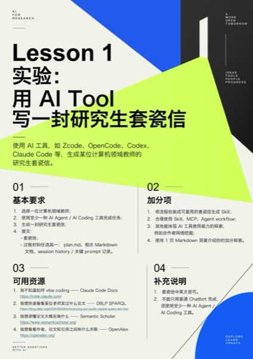
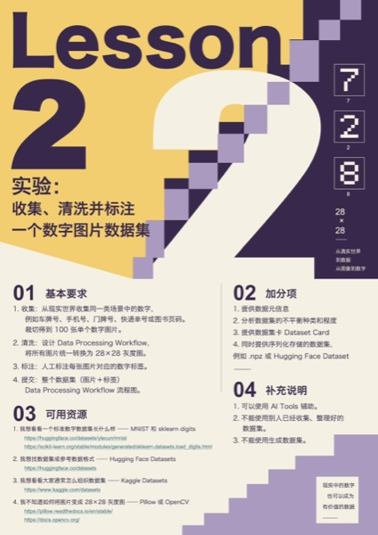
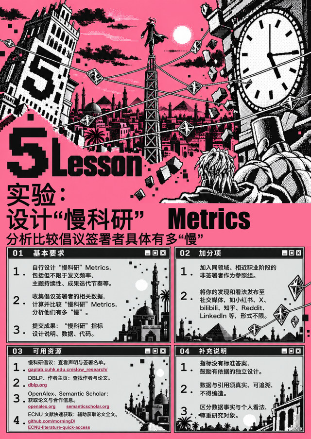

# Course-2026Fall

华东师范大学数据科学与工程学院《统计方法与机器学习》2026 年秋季课程仓库。

## 📋 分组报名（进行中）

👉 **[点此报名分组](https://github.com/DaSE-ML/Course-2026Fall/issues/new?template=group-signup.yml)**：每组 **4–5 人**，只需粘贴全组成员的 GitHub 用户名（每行一个 `@用户名`），提交后机器人**自动分配组号**（ML26-01 起）并回帖确认。⚠️ 请勿在报名中填写真实姓名、学号等个人信息。名单变动时编辑报名 issue 即可自动更新。

各组后续在对应的私有仓库 `ML26-01` ~ `ML26-25` 中提交作业与项目（仅本组成员与教师可见）。

## 🧪 实验课任务

<table>
  <thead>
    <tr>
      <th width="130">任务</th>
      <th width="340">任务海报（点击看全图）</th>
      <th width="330">提交目录与交付物</th>
    </tr>
  </thead>
  <tbody>
    <tr>
      <td valign="top"><strong>Lesson 1</strong>  用 AI Tool 写一封研究生 套瓷信</td>
      <td align="center" valign="top"></td>
      <td valign="top">
        
<strong>提交到哪里？</strong> 各组私有仓库 <code>ML26-XX</code> 根目录下的 <code>lab01/</code> 文件夹。

        
<strong>提交什么？</strong> ① 套瓷信（中英文皆可） ② 一份过程材料，以下任选其一：

        <ul>
          <li><code>plan.md</code></li>
          <li>相关 Markdown 文档</li>
          <li>session history / 关键 prompt 记录</li>
        </ul>
      </td>
    </tr>
    <tr>
      <td valign="top"><strong>Lesson 2</strong>  收集、清洗 并标注一个 数字图片数据集</td>
      <td align="center" valign="top"></td>
      <td valign="top">
        
<strong>提交到哪里？</strong> 各组私有仓库 <code>ML26-XX</code> 根目录下的 <code>lab02/</code> 文件夹。

        
<strong>提交什么？</strong> ① 整个数据集（图片与标签） ② Data Processing Workflow 流程图

        
<strong>数据要求</strong> 从现实世界收集，不可使用现成或生成的数据集。可以使用 AI Tools 辅助。

      </td>
    </tr>
    <tr>
      <td valign="top"><strong>Lesson 3</strong>  机器邪修锦囊</td>
      <td align="center" valign="top"></td>
      <td valign="top">
        
<strong>提交到哪里？</strong> 各组私有仓库 <code>ML26-XX</code> 根目录下的 <code>lab03/</code> 文件夹。

        
<strong>提交什么？</strong> Jupyter Notebook（<code>.ipynb</code>），包含代码和实验结果。

        
<strong>基本要求</strong> 基于公开数据集，分别复现任意 4 个锦囊，比较使用前后的实验结果。

      </td>
    </tr>
    <tr>
      <td valign="top"><strong>Lesson 4</strong>  群雄逐鹿： Kaggle 初出茅庐</td>
      <td align="center" valign="top"></td>
      <td valign="top">
        
<strong>提交到哪里？</strong> 各组私有仓库 <code>ML26-XX</code> 根目录下的 <code>lab04/</code> 文件夹。

        
<strong>提交什么？</strong> 方案解读文档，附比赛及 Top-1 方案来源链接。

        
<strong>基本要求</strong> 六选一，了解比赛任务、数据和评价指标，详细解读 Top-1 方案。

        
详细要求与加分项见<a href="assignments/lab04.md">实验说明</a>和任务海报。

        
<strong>相关资料</strong> <a href="assignments/resources/lab04-kaggle.md">六张人物牌对应的 Kaggle 比赛链接</a>

      </td>
    </tr>
    <tr>
      <td valign="top"><strong>Lesson 5</strong>  设计“慢科研” Metrics</td>
      <td align="center" valign="top"></td>
      <td valign="top">
        
<strong>提交到哪里？</strong> 各组私有仓库 <code>ML26-XX</code> 根目录下的 <code>lab05/</code> 文件夹。

        
<strong>提交什么？</strong> ① “慢科研”指标设计说明（1–2 页 A4 PDF） ② 数据和代码 ③ 社交媒体分享链接（如有）

        
<strong>基本要求</strong> 自行设计指标，收集倡议签署者的相关数据，计算并比较他们具体有多“慢”。

        
详细要求、加分项与资源见<a href="assignments/lab05.md">实验说明</a>和任务海报。

        
<strong>相关材料</strong> <a href="assignments/resources/README.md">倡议与签署名单备份（2026-10-17 快照）</a>，原网页不可达时可下载参考。

      </td>
    </tr>

  </tbody>
</table>

**统一提交方式：** 作业按组计，全组共用一份提交。将成果放入表中对应目录后直接 push 即可。组内自行协调分工与文件命名；看不到本组仓库请联系助教。详细要求与加分项见任务海报。

## 📊 小组作业进度（参考）

<!-- group-progress:start -->
**各组完成情况一览**（参考数据，更新于 2026-10-23 16:46 · 共 8 次作业）

Lesson 4 已发布，L4 列暂未统计（·）；其余列仍为上述时间的参考快照。

| 组 | L1 | L2 | L3 | L4 | L5 | 🔒L6 | 🔒L7 | 🔒L8 |
|---|---|---|---|---|---|---|---|---|
| 01 | 🟢 | 🟢 | 🟢 | · | ⚪ | · | · | · |
| 02 | 🟢 | 🟢 | 🟢 | · | ⚪ | · | · | · |
| 03 | 🟢 | 🟢 | 🟢 | · | ⚪ | · | · | · |
| 04 | 🟢 | 🟢 | 🟢 | · | ⚪ | · | · | · |
| 05 | 🟢 | ⚪ | ⚪ | · | ⚪ | · | · | · |
| 06 | 🟢 | ⚪ | ⚪ | · | ⚪ | · | · | · |
| 08 | 🟢 | 🟢 | 🟢 | · | ⚪ | · | · | · |
| 09 | ⚪ | 🟢 | 🟢 | · | ⚪ | · | · | · |
| 10 | ⚪ | 🟢 | ⚪ | · | ⚪ | · | · | · |
| 11 | ⚪ | ⚪ | ⚪ | · | ⚪ | · | · | · |
| 12 | 🟢 | 🟢 | 🟢 | · | ⚪ | · | · | · |
| 13 | ⚪ | 🟢 | 🟢 | · | ⚪ | · | · | · |
| 14 | ⚪ | ⚪ | ⚪ | · | ⚪ | · | · | · |
| 15 | 🟢 | ⚪ | ⚪ | · | ⚪ | · | · | · |
| 16 | ⚪ | ⚪ | ⚪ | · | ⚪ | · | · | · |
| 17 | ⚪ | 🟢 | ⚪ | · | ⚪ | · | · | · |
| 18 | 🟢 | ⚪ | ⚪ | · | ⚪ | · | · | · |
| 19 | 🟢 | ⚪ | ⚪ | · | ⚪ | · | · | · |
| 20 | 🟢 | 🟢 | 🟢 | · | ⚪ | · | · | · |
| 21 | ⚪ | ⚪ | ⚪ | · | ⚪ | · | · | · |
| 22 | 🟢 | ⚪ | ⚪ | · | ⚪ | · | · | · |
| 23 | ⚪ | ⚪ | ⚪ | · | ⚪ | · | · | · |
| 25 | 🟢 | 🟢 | 🟢 | · | ⚪ | · | · | · |

图例：🟢 基础材料齐备　🟡 进行中　⚪ 未开始　· 暂无统计数据　🔒 该次作业尚未发布。本表仅为参考快照，不构成评分依据。
<!-- group-progress:end -->

## 机器学习课程材料

机器学习部分面向本科三年级学生，共 10 讲、20 课堂学时，内容包括回归、分类、模型评估、模型选择、树与集成、支持向量机、无监督学习、文本表示与预训练模型。

学生材料位于 **[ml-2026/](ml-2026/)**，包括课件、实验 notebook、实验阅读版和作业说明。目前开放第1、2、3、4、5、6讲，其余内容将随课程进度发布。

进入 **[课程入口](ml-2026/index.html)** 可查看已经开放的章节。课件和实验阅读版可直接在浏览器中打开；需要运行 notebook 时，请按照 [环境与运行说明](ml-2026/README.md) 启动 JupyterLab。

## 课程讨论

欢迎同学们参与 [Discussions](https://github.com/DaSE-ML/Course-2026Fall/discussions)，交流课程内容、实验结果、学习体会和相关资料。发帖前请先搜索是否已有相近主题，并避免公开密码、Token、学号、电话等敏感信息。
