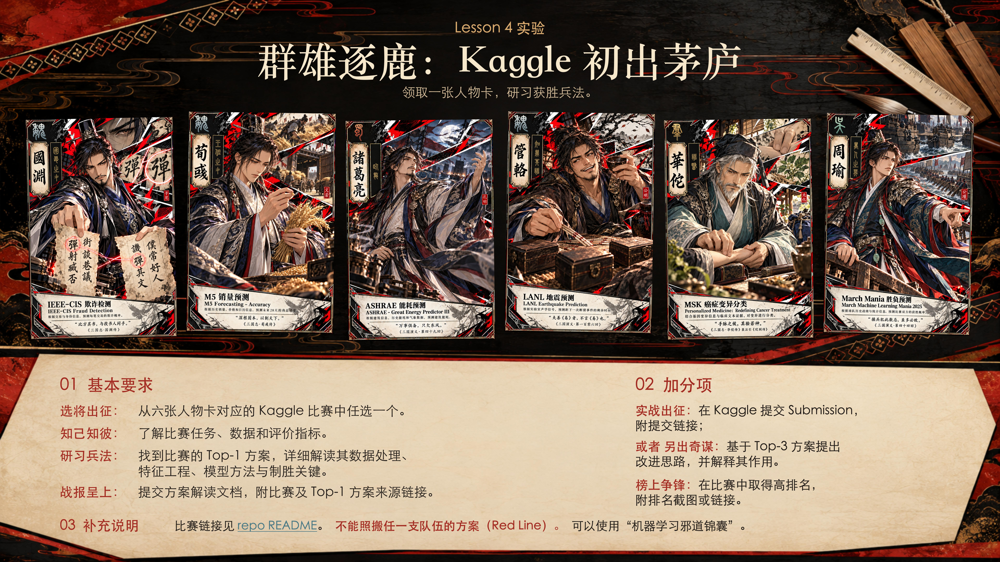

# Lesson 4：群雄逐鹿：Kaggle 初出茅庐

领取一张人物卡，研习获胜兵法。

## 01 基本要求

1. **选将出征**：查看人物卡对应的 Kaggle 比赛。
2. **知己知彼**：了解比赛任务、数据和评价指标。
3. **研习兵法**：找到比赛的 Top-1 方案，详细解读其数据处理、特征工程、模型方法与制胜关键。
4. **战报呈上**：提交方案解读文档，附比赛及 Top-1 方案来源链接。

## 02 加分项

- **实战出征**：在 Kaggle 提交 Submission，附提交链接；
  **或者 另出奇谋**：基于 Top-3 方案提出改进思路，并解释其作用。
- **榜上争锋**：在比赛中取得高排名，附排名截图或链接。

## 03 补充说明

- 比赛链接见[相关资料：六张人物牌与 Kaggle 比赛](resources/lab04-kaggle.md)。
- **不能照搬任一支队伍的方案（Red Line）。**
- 可以使用“机器学习邪道锦囊”。

## 提交方式

按组提交到各组私有仓库 `ML26-XX` 根目录下的 `lab04/` 文件夹，直接 push。

基本交付物为方案解读文档，附比赛及 Top-1 方案来源链接。参与加分项的同学同时附上对应提交链接、改进方案或排名截图／链接。

