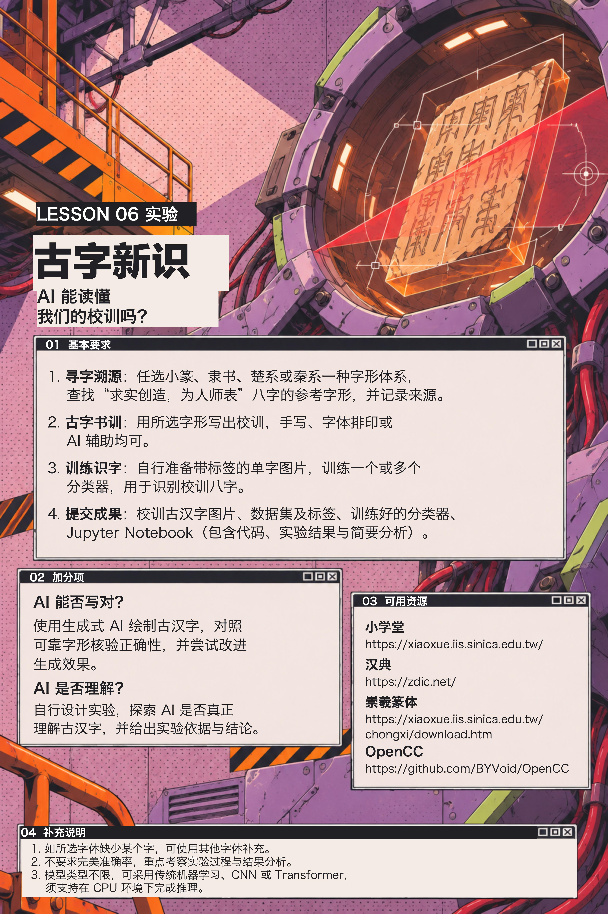

# Lesson 6：古字新识：AI 能读懂我们的校训吗？

## 01 基本要求

1. **寻字溯源**：任选小篆、隶书、楚系或秦系一种字形体系，查找“求实创造，为人师表”八字的参考字形，并记录来源。
2. **古字书训**：用所选字形写出校训，手写、字体排印或 AI 辅助均可。
3. **训练识字**：自行准备带标签的单字图片，训练一个或多个分类器，用于识别校训八字。
4. **提交成果**：校训古汉字图片、数据集及标签、训练好的分类器、Jupyter Notebook（包含代码、实验结果与简要分析）。

## 02 加分项

- **AI 能否写对？** 使用生成式 AI 绘制古汉字，对照可靠字形核验正确性，并尝试改进生成效果。
- **AI 是否理解？** 自行设计实验，探索 AI 是否真正理解古汉字，并给出实验依据与结论。

## 03 可用资源

1. 小学堂：https://xiaoxue.iis.sinica.edu.tw/
2. 汉典：https://zdic.net/
3. 崇羲篆体：https://xiaoxue.iis.sinica.edu.tw/chongxi/download.htm
4. OpenCC：https://github.com/BYVoid/OpenCC

## 04 补充说明

1. 如所选字体缺少某个字，可使用其他字体补充。
2. 不要求完美准确率，重点考察实验过程与结果分析。
3. 模型类型不限，可采用传统机器学习、CNN 或 Transformer，须支持在 CPU 环境下完成推理。

## 提交方式

按组提交到各组私有仓库 `ML26-XX` 根目录下的 `lab06/` 文件夹，直接 push。提交以下材料：

1. 校训古汉字图片。
2. 数据集及标签。
3. 训练好的分类器（一个或多个）。
4. Jupyter Notebook（`.ipynb`），包含代码、实验结果与简要分析。

